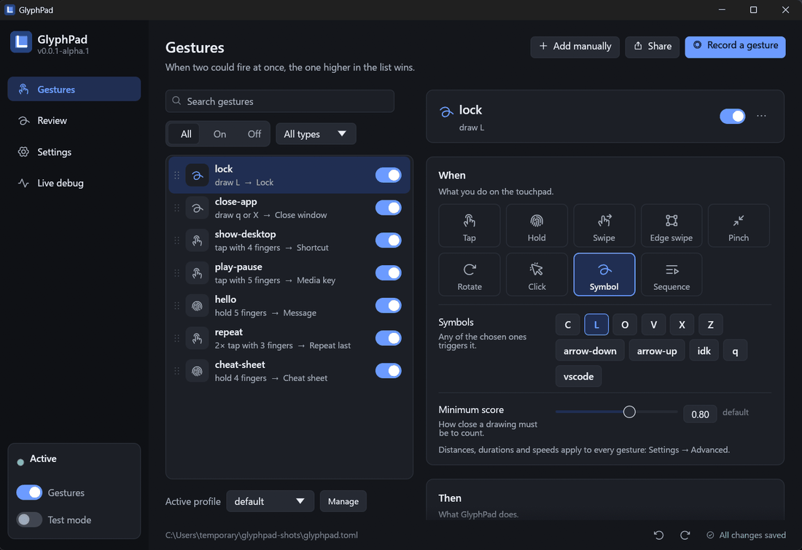
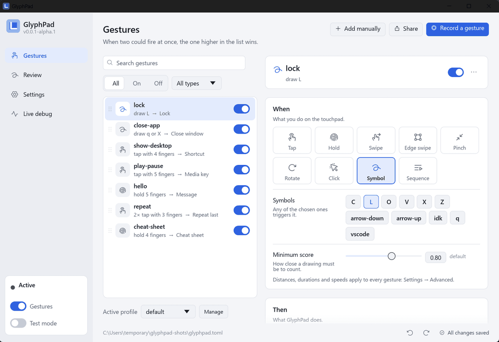

# GlyphPad

**Custom gestures for your touchpad.** Draw an **L** to lock the PC, an **X** to close the
window in front, tap with four fingers to open a terminal, swipe with five to run a script.
GlyphPad reads every finger on a Windows Precision Touchpad, recognizes the gestures *you*
define, and runs the action you chose.

<p align="center">
  
  
</p>

- **Drawn symbols**: letters and shapes, with one stroke or several, learned from your own
  examples. Built in: L, q, X, C, V, Z, O and arrows.
- **Classic gestures**: taps and multi-taps, holds, swipes in 8 directions, edge swipes,
  pinch, rotate, click and drag, "one finger rests while others move" chords, and sequences.
- **Lots of actions**: shortcuts, lock, close/minimize/maximize, run a program, media keys,
  open a file or address, type a text, snap windows, switch virtual desktops, screenshots,
  switch profile, chain several actions, and more.
- **Per-app and profiles**: a gesture can work only in some programs or in a profile, and
  profiles can switch by themselves.
- **A real window** to do everything, with light and dark themes, English and Italian, and
  changes saved as you make them. The file `glyphpad.toml` stays the source of truth if you
  prefer editing text.
- **Portable and light**: one executable, no installer, no administrator rights, nothing
  running when idle but the engine. No telemetry: the only network access is the optional
  update check on this project's GitHub releases.

> **Status: alpha, Windows only for now.** Linux support is planned. The specification is
> in [`docs/SPEC.md`](docs/SPEC.md).

## Requirements

- Windows 10 or 11 and a **Precision Touchpad** (most laptops since 2015 and many external
  touchpads). Run `glyphpad dump-descriptor` to see whether yours is found.
- That's all: no drivers, no administrator rights.

## Install

1. Download `glyphpad-<version>-x86_64-pc-windows-msvc.zip` from the
   [Releases](https://github.com/wildzer0/glyphpad/releases) page and unzip it anywhere.
2. Run `glyphpad.exe`. It lives in the system tray and opens its window.

Windows SmartScreen may say "Windows protected your PC" the first time, because the program
is not code-signed yet: choose *More info* → *Run anyway*. You can check the download against
the `SHA256SUMS` file of the release.

**Portable mode:** if a file named `glyphpad.toml` sits next to `glyphpad.exe`, GlyphPad uses
it, and keeps its other files there too. Otherwise it uses `%APPDATA%\GlyphPad\config\`.
To uninstall, delete the folder (and turn off *Start with Windows* first if you used it).

## Your first five minutes

1. **Turn off Windows' own three-finger gestures** (Settings → Bluetooth & devices →
   Touchpad → Three-finger gestures → *Nothing*). Symbols are drawn with three fingers by
   default, and Windows would otherwise react to them too.
2. Open the **Gestures** page. A few examples are already there: draw an **L** with three
   fingers and the PC locks; hold four fingers and the cheat sheet appears.
3. Press **Record a gesture**: choose *A symbol*, name it, draw it five times, check the
   quality report, choose what it should do. Done: it is saved already.
4. Not sure it works? Switch **Test mode** on (bottom left): gestures are recognized and
   shown, but nothing runs.

Everything is explained in the **[User guide](docs/USER_GUIDE.md)**
([in Italian](docs/GUIDA_UTENTE.md)). The complete list of settings, gesture fields and
actions is in the **[configuration reference](docs/CONFIGURATION.md)**.

## Documentation

| | |
|---|---|
| [User guide](docs/USER_GUIDE.md) · [Guida utente](docs/GUIDA_UTENTE.md) | Installing, recording gestures, every page of the window, profiles, sharing, updates, troubleshooting |
| [Configuration reference](docs/CONFIGURATION.md) | Every setting, gesture type, action and condition of `glyphpad.toml`; the files GlyphPad keeps; the command line |
| [Design guide](docs/DESIGN.md) | Architecture with diagrams: modules, threads, data flow, state machines, how to change things |
| [Architecture](docs/ARCHITECTURE.md) | How the code is organized, and the known limitations |
| [Specification](docs/SPEC.md) | The project's binding specification |
| [Changelog](CHANGELOG.md) | What changed in each version |

## Privacy

GlyphPad reads the touchpad only. It never records the keyboard. Nothing is sent anywhere;
the update check (a request to GitHub's public releases API, which you can turn off in
Settings → Updates) is the only network use. Usage counters, if you keep them on, stay in
`stats.json` on your computer.

## Building from source

Requires the latest stable Rust toolchain (`rustup`).

```sh
cargo build --release          # target/release/glyphpad(.exe)
cargo test --workspace
cargo clippy --workspace --all-targets -- -D warnings
```

On Linux the window and tray need GTK, xdo and AppIndicator headers, e.g. on Debian/Ubuntu:

```sh
sudo apt-get install libgtk-3-dev libxdo-dev libayatana-appindicator3-dev
```

Releases are made with `cargo xtask release <version>` and published by the tag-triggered
workflow; see the architecture document.

## License

[MIT](LICENSE). The icons are [Phosphor Icons](https://phosphoricons.com) (MIT), see
`crates/gui/assets/Phosphor-LICENSE.txt`.
