# GlyphPad: design and architecture guide

This is the document to read before changing the code. It explains **what the pieces are, how data
moves between them, why they are shaped this way**, and where to touch the code for the common
changes. It complements, and does not replace:

| Document | Use it for |
|---|---|
| [`SPEC.md`](SPEC.md) | The binding requirements. When code and spec disagree, the spec wins (or is changed on purpose). |
| [`ARCHITECTURE.md`](ARCHITECTURE.md) | Short per-area notes and the list of **known limitations**. |
| **this file** | The whole picture: diagrams, flows, state machines, invariants, recipes. |
| [`CONFIGURATION.md`](CONFIGURATION.md), [`USER_GUIDE.md`](USER_GUIDE.md) | What the user sees and writes. |

The diagrams are [Mermaid](https://mermaid.js.org/): GitHub renders them, as does the VS Code
"Markdown Preview Mermaid Support" extension.

Contents:
1. [What GlyphPad is](#1-what-glyphpad-is)
2. [Workspace and dependencies](#2-workspace-and-dependencies)
3. [Threads and ownership at runtime](#3-threads-and-ownership-at-runtime)
4. [The data model](#4-the-data-model)
5. [From finger to action: the whole pipeline](#5-from-finger-to-action-the-whole-pipeline)
6. [The Windows touch backend](#6-the-windows-touch-backend)
7. [The gesture engine](#7-the-gesture-engine)
8. [Drawn symbols](#8-drawn-symbols)
9. [Dispatcher and sequences](#9-dispatcher-and-sequences)
10. [Configuration](#10-configuration)
11. [The service (engine thread)](#11-the-service-engine-thread)
12. [Actions and feedback](#12-actions-and-feedback)
13. [The window (GUI) and the tray](#13-the-window-gui-and-the-tray)
14. [Updates](#14-updates)
15. [Build, CI and release](#15-build-ci-and-release)
16. [Testing strategy](#16-testing-strategy)
17. [Invariants and pitfalls](#17-invariants-and-pitfalls)
18. [Recipes: how to change X](#18-recipes-how-to-change-x)
19. [File map](#19-file-map)

---

## 1. What GlyphPad is

A Windows program (Linux planned, macOS out of scope) that reads the **raw multi-touch data** of a
Precision Touchpad, recognizes gestures the user defines (taps, swipes, pinch, drawn symbols,
sequences…) and runs an action for each one. It is a single portable executable: no installer, no
administrator rights, no network except an optional update check.

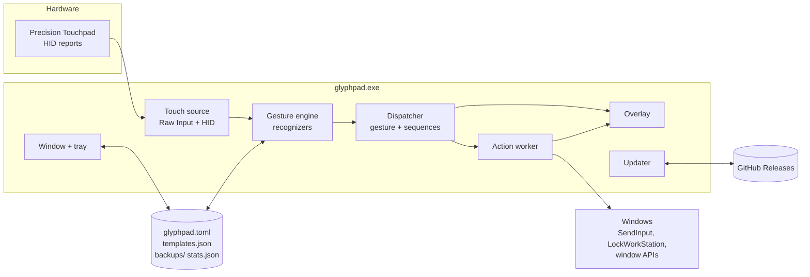

Important fact (SPEC §5): Raw Input only **reads**. Windows keeps moving the cursor and running its
own gestures. That is why *draw mode* exists (three fingers by default, so the pointer does not
move) and why GlyphPad warns when Windows' native three-finger gestures are on.

---

## 2. Workspace and dependencies

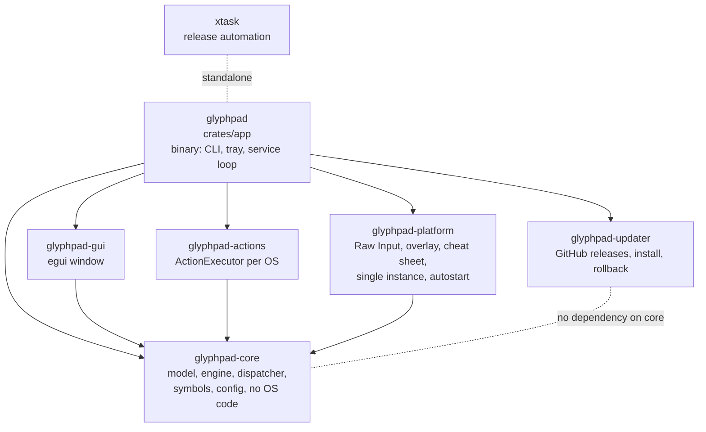

| Crate | Responsibility | Never contains |
|---|---|---|
| `core` | Everything that can run and be tested without an OS: data model, recognizers, symbol matching, dispatcher, config parse/edit, history/stat types, the `Shared`/`Command` contract with the UI. | Any OS API, any `unsafe`. |
| `platform` | `ptp` (portable HID math, tested everywhere) and `windows/` (the only `unsafe` FFI together with `actions/windows.rs`): Raw Input source, overlay, cheat sheet, single instance, autostart, cursor freeze, native-gesture detection. | Gesture logic. |
| `actions` | `ActionExecutor` and `ForegroundInfo` implementations (`SendInput`, lock, close window…). Non-Windows builds get a stub that returns "not implemented". | Decisions about *when* to run. |
| `gui` | A *view*: reads `Shared`, sends `Command`s. Own design system, i18n. | Engine state, file writes. |
| `updater` | `UpdateSource` (GitHub / local folder), download + SHA256 verify, executable swap, handoff with rollback. **The only place that names the GitHub repo** (`GITHUB_REPO`). | UI. |
| `app` | Wiring: CLI (`clap`), single instance, the **service** (engine thread), tray, update thread, config files. | Recognition logic. |
| `xtask` | `release`, `changelog`, `check-tag`. Not shipped. | |

Rules enforced by the build (see also `Cargo.toml`, `.cargo/config.toml`):

- `unsafe_code = "deny"` workspace-wide. FFI modules opt in with `#[allow(unsafe_code)]` and a
  comment per block saying why it is sound.
- Windows MSVC links the CRT statically (`+crt-static`): no VC++ redistributable needed.
- Release profile: fat LTO, one codegen unit, stripped, `panic = "unwind"` (a panicking backend
  thread can be caught).
- Package names carry the `glyphpad-` prefix because a crate called `core` would clash with Rust's.
- Version lives only in `[workspace.package] version` of the root `Cargo.toml`.

---

## 3. Threads and ownership at runtime

`glyphpad run` (the default command) creates these threads. Everything that mutates engine state
lives on **one** thread (`engine`); everyone else talks to it through channels or the `Shared`
snapshot.

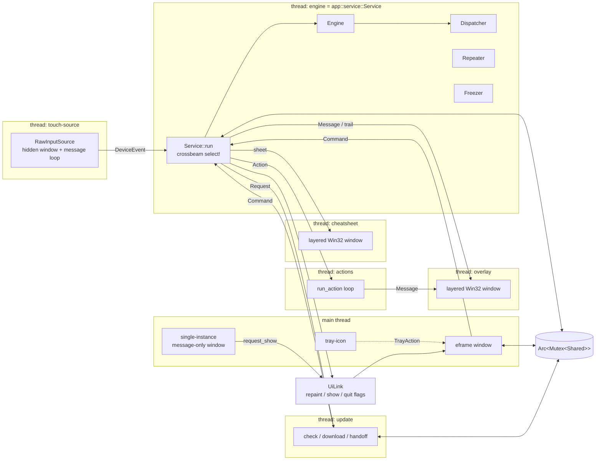

Why this shape:

- **The engine never depends on the window** (SPEC §10.1). The window can be hidden or not exist
  (the CLI commands `capture`, `replay`, `record` run without it) and recognition keeps working.
- **Idle cost is ~0**: `Service::run` blocks in `select!` until the next *deadline* (see §7.5), a
  command or an event. A hidden window gets no repaints; `UiLink::wake` is only called for touch
  frames when the window is visible.
- **Actions run on their own thread** so a slow action (`wait`, a program starting) never delays
  recognition. The price: the engine only learns an action was *sent*, not that it finished.
- **Overlay and cheat sheet are plain Win32 windows on their own threads**, independent of eframe,
  so they work while the main window is hidden.

---

## 4. The data model

Defined in `core/src/model.rs`, produced by every backend, serialized as JSON Lines by `capture`.

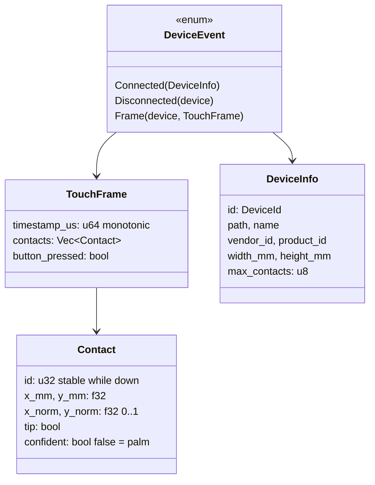

Key points:

- **Millimeters everywhere.** Every spatial threshold is in mm so a configuration works on any
  touchpad size. `x_norm/y_norm` exist for edge zones and for drawing on a pad-shaped canvas.
- `TouchFrame::active_contacts()` = `tip && confident` (palms excluded).
- A frame lists **all** contacts of one scan, including the ones being lifted (`tip == false`).
  The frame that lifts the last finger is the only message saying "nothing touches any more"; code
  that throttles frames must never drop it (see §17).
- `timestamp_us` is the *frame time base*: the HID Scan Time converted to monotonic microseconds.
  All engine deadlines are in this base. The live loop maps wall-clock time onto it with
  `Service::clock` (last frame timestamp + elapsed since it arrived).
- `DeviceId` is per source session; a replugged device may get a new id. `DeviceInfo.path`
  identifies the physical device.

---

## 5. From finger to action: the whole pipeline

```mermaid
sequenceDiagram
    autonumber
    participant HW as Touchpad
    participant SRC as touch-source thread
    participant SVC as engine thread (Service)
    participant ENG as Engine
    participant DSP as Dispatcher
    participant AW as actions thread
    participant OS as Windows
    participant UI as Window / overlay

    HW->>SRC: HID input report(s) (WM_INPUT)
    SRC->>SRC: parse via preparsed data,<br/>assemble hybrid frames,<br/>mm + scan-time clock
    SRC->>SVC: DeviceEvent::Frame
    SVC->>ENG: on_event(frame)
    ENG->>ENG: SessionTracker + recognizers
    ENG-->>SVC: Vec<Recognition> (maybe empty)
    SVC->>UI: contacts, trail (throttled to 16 ms)
    loop each Recognition
        SVC->>SVC: foreground app lookup
        SVC->>DSP: on_recognition(config, r, app)
        DSP-->>SVC: Vec<Dispatched> (gesture index or None)
    end
    SVC->>DSP: observe(engine.busy_since()); tick(now)
    DSP-->>SVC: held gestures that timed out
    SVC->>SVC: execute(): pause checks, repeat_last,<br/>history, stats
    SVC->>AW: Action
    AW->>OS: SendInput / LockWorkStation / ...
    SVC->>UI: overlay message ("lock", "Not recognized"…)
```

A **Recognition** (`core/src/engine/mod.rs`) is what the engine reports:

| Field | Meaning |
|---|---|
| `observation` | *What* happened (`Tap`, `Swipe`, `Pinch`, `Symbol`, `UnrecognizedSymbol`, `Sample`…), independent of configuration. |
| `at_us` | Frame time when it was **recognized**. |
| `started_us` / `ended_us` | When the movement itself **began / ended**. For a tap or swipe these are touch-down and lift; for a drawn symbol, the first point and the last lift (the recognition comes `stroke_gap_ms` later). Sequences measure with these. |
| `trace` | The finger paths with times, for the history and its animated replay. |

The engine knows nothing about gestures as configured; it only knows what the configuration
*needs it to look for* (the `Spec`, §7.3). The **Dispatcher** then maps an observation to the
configured gesture (`resolve`) and handles sequences.

---

## 6. The Windows touch backend

`platform/src/windows/` (FFI, `unsafe` allowed) and `platform/src/ptp.rs` (pure Rust, tested on any
OS).

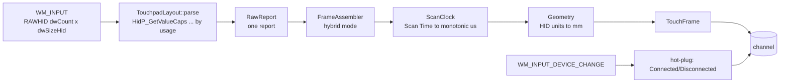

- `source.rs`: a hidden window (message-only by default; `--toplevel-window` uses a hidden
  top-level one if background input does not arrive) registered for usage page `0x0D` / usage
  `0x05` with `RIDEV_INPUTSINK | RIDEV_DEVNOTIFY`. One `WM_INPUT` may carry several reports.
- `hid.rs`: finds every value (Contact ID `0x51`, Tip `0x42`, Confidence `0x47`, X/Y, Scan Time
  `0x56`, Contact Count `0x54`, Maximum `0x55`, Button) through the **preparsed data** by usage page,
  usage and link collection (one collection per finger). **Never by byte offset.**
- `ptp.rs::FrameAssembler`: *hybrid reporting mode*. A frame may arrive in several reports; only the
  first carries the real Contact Count, later ones carry 0. The assembler accumulates contacts
  until the frame is complete.
- `device.rs`: enumerates touchpads, physical size from physical min/max + unit + exponent,
  max contacts from the feature report when the handle can be opened (else derived; see
  `dump-descriptor`, which prints the source).
- Reconnection: the source re-registers on device change; the engine drops the device state on
  `Disconnected` and creates a fresh one on the next frame.
- Other modules: `foreground.rs` (app name/title), `cursor.rs` (`ClipCursor` freeze guard, released
  at start if a crash left it), `native_gestures.rs` (reads the Windows touchpad settings from the
  registry to warn about conflicts), `autostart.rs` (HKCU `Run`), `single_instance.rs`,
  `overlay.rs`, `cheatsheet.rs`, `console.rs` (attach to the parent console for CLI output from a
  GUI-subsystem binary).

The `TouchSource` trait lives in **core** (not platform) because core's `ReplaySource` implements
it too; that is what makes captures replayable as if they were live.

---

## 7. The gesture engine

`core/src/engine/`. One `Engine` holds a `DeviceState` per device; nothing in it reads the clock
or the OS, so it is deterministic: the same frames produce the same recognitions.

### 7.1 Parts

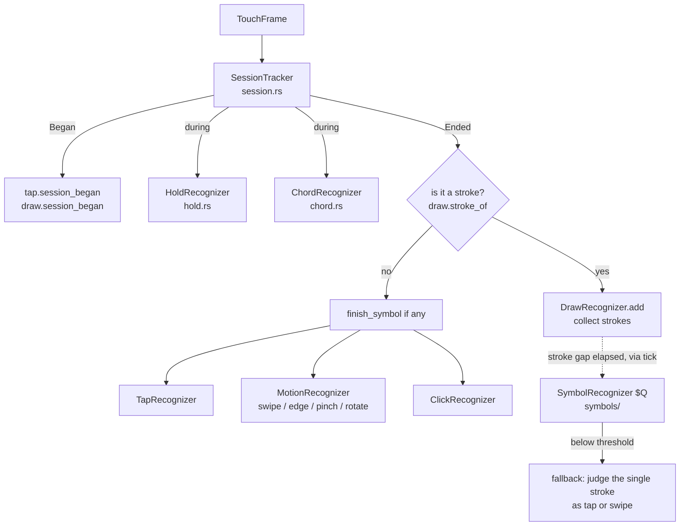

| Piece | Role |
|---|---|
| `SessionTracker` / `Session` | A **session** = first finger down → last finger up. Tracks fingers (position, drift), max fingers, button, the *peak phase* (the stretch with the most fingers down, before the first lift), per-finger paths with times, the centroid trace. All recognizers read the session. |
| `TapRecognizer` | Taps and multi-taps. Fires on lift, or waits `multi_tap_gap_ms` **only if** a gesture with more taps and the same finger count exists. |
| `HoldRecognizer` | Fires *while the fingers are still down* once they rested `hold_duration_ms` within `hold_max_movement_mm`; **consumes** the session. Armed only for finger counts a hold gesture uses. |
| `MotionRecognizer` | Swipe, edge swipe, pinch, rotate, measured together on the peak phase, decided on lift; the one that exceeds its threshold by the largest factor wins. 4 or 8 directions (`quantize`). |
| `ClickRecognizer` | Sessions with the physical button: click, click-and-drag. A click session produces no other gesture. |
| `ChordRecognizer` | Fingers resting ≥ 250 ms act as modifiers while others tap/swipe; the session's own gesture is then void. |
| `DrawRecognizer` | Decides which sessions are strokes (per draw mode), collects strokes until `stroke_gap_ms`, hands the symbol to `SymbolRecognizer`. |

### 7.2 What happens in `on_frame`

Order matters (`engine/mod.rs::on_frame`):

1. `tracker.update(frame)` → `None | Began | Updated | Ended`.
2. **Ended**: if the session is a stroke → flush pending taps ("a tap sequence cannot continue
   through a stroke") and add it to the draw recognizer. Otherwise → finish any symbol in progress,
   then run tap, motion and click recognizers on the finished session.
3. **Began / Updated**: on Began, confirm pending taps and finish an overdue symbol; then give the
   live session to hold and chord.
4. Stamp every produced observation with `at_us`, `ended_us`, `started_us` (see `ended_of`,
   `started_of`) and return `Vec<Recognition>`.

### 7.3 `Spec` and `Thresholds`

`Spec::from_config(&Config)` derives *what to look for*: which finger counts can tap with how many
taps, hold, swipe (and 8-way), pinch, rotate, click, chord; the draw parameters; the confidence
threshold per configured symbol. **Steps of sequences are included**, so they are recognized as if
they were gestures of their own. `Spec::everything()` recognizes every variant (used by `replay
--all` and the demonstration wizard). `Thresholds` are the mm/ms limits from `[settings]`.

Consequence: adding a gesture changes behaviour of *other* gestures (e.g. a configured double-tap
makes single taps with that finger count wait `multi_tap_gap_ms`).

### 7.4 Observations vs gestures

`Observation` is the engine's vocabulary (tap, hold, swipe, edge swipe, pinch, rotate, click,
chord, symbol, unrecognized symbol, sample). `core/src/trigger.rs` defines `Trigger` (a validated
gesture description, also used for each sequence step) and `Trigger::specificity(observation,
default_confidence) -> u8` (0 = no match; higher = more specific). `engine::resolve` picks, among
the gestures that match and apply to the active profile and foreground app, the **most specific**,
ties broken by **file order** (priority).

### 7.5 Time, ticks and deadlines

The engine has no timer. The host must call `Engine::tick(now_us)` at the moments given by
`Engine::next_deadline()` (taps waiting for a second tap, hold timers, a drawing waiting for the
stroke gap, stale sessions). `Engine::process_all` and `dispatch::run_all` do this
deterministically for captures and tests; `Service::run` does it with `select!` + timeout in live
use. A session whose device has been silent for 1.5 s is dropped (`STALE_SESSION_US`), so a lost
"finger up" cannot wedge the engine.

`Engine::busy_since()` reports the start of the touch or drawing **in progress** (an active
session, or a symbol collecting strokes). The dispatcher uses it (§9).

---

## 8. Drawn symbols

`core/src/symbols/` and `engine/draw.rs`.

**Which touches are strokes** (`DrawRecognizer::stroke_samples`) depends on `settings.draw_activation`:

| Mode | A session is a stroke when |
|---|---|
| `fingers {count}` (default 3) | `max_fingers == count`; only the moments with exactly `count` fingers are used (landing and lifting are cut). |
| `edge {edge, zone_percent}` | One finger that starts in the zone. |
| `hold {ms}` | One finger rests, then draws (samples from the rest on). |
| `toggle` | One finger, only after an action `draw_symbol` armed it (`Engine::arm_drawing`). |

Once a symbol is under way (or armed), a one-finger touch continues it whatever the mode.
`freeze_cursor` (one-finger modes, experimental) pins the pointer with `ClipCursor` while drawing
(`app::engine_loop::Freezer`).

**Collecting and recognizing**:

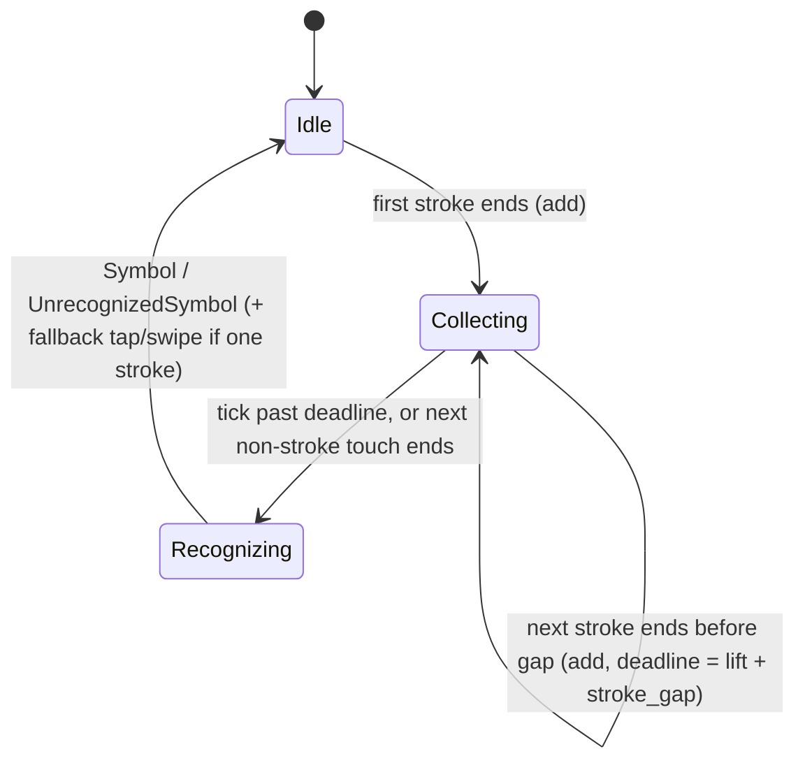

- `$Q` (`symbols/dollar_q.rs`): resample to 64 points (never across strokes), scale uniformly, center;
  greedy point-cloud matching with lower bounds and early abandoning. Independent of stroke order
  and direction; **orientation matters** unless `rotation_tolerance_deg` > 0.
- Score = `1 − rms / ZERO_SCORE_RMS` (0.4), calibrated on real captures (see the comment on the constant).
- `templates.json` stores the user's samples with per-point timestamps (animated replay depends on
  them). Effective templates = built-ins (7 proportion/slant variants each) + user samples; a
  symbol may hide its built-ins.
- A symbol is **accepted only if a configured gesture uses it and the score reaches that gesture's
  confidence** (`Spec::symbol_threshold`). Otherwise an `UnrecognizedSymbol` diagnostic is emitted
  (best candidates, shown in the log and overlay) and, if there was a single stroke, the same
  session is judged as a tap or swipe (`Finished::fallback`).
- Hence: **gestures made with the drawing finger count (e.g. 3-finger swipes) fire `stroke_gap_ms`
  after the lift.** This is inherent, not a bug, and it is why `Recognition` has both `at_us` and
  `ended_us`.
- Hazard to know: a straight 3-finger swipe also *competes* with configured symbols; a clean line
  can score close to `arrow-up/down` and, if a gesture uses one of those with a low threshold, it
  could be taken for the symbol.

---

## 9. Dispatcher and sequences

`core/src/dispatch.rs`. It sits between the engine and the actions and is the only place that
knows about **sequences**.

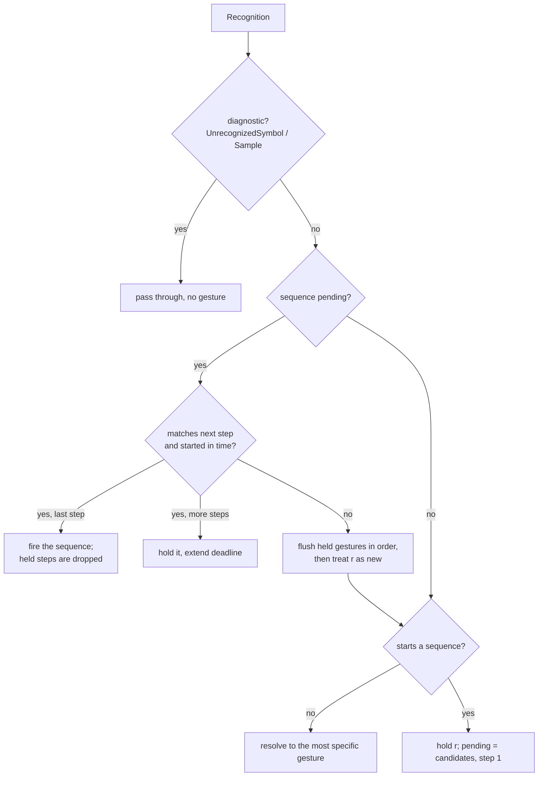

**`within_ms` semantics (important, changed in 1.0.2).** It limits the **pause between the end of one
step and the *start* of the next**, not the time the next step takes. A step is accepted when
`r.started_us <= previous.ended_us + within_ms`.

```mermaid
gantt
    dateFormat  X
    axisFormat  %s
    title Sequence: tap, then 3-finger swipe (within_ms = 800)
    section Step 1
    tap (ended_us)          :done, a, 0, 70
    section Pause
    pause, must be <= 800   :active, b, 70, 670
    section Step 2
    swipe touch-down .. lift (started_us .. ended_us) :c, 670, 880
    recognized after stroke_gap :milestone, 1280, 1280
```

Here the pause is 600 ms: fine. With the old rule (end of step 2 ≤ 800) it would have broken.

**Waiting for a step in progress.** The held gestures are released when the pause expires *unless
the engine reports a touch that began in time*. The service calls `Dispatcher::observe(
engine.busy_since())` after every engine step; `Dispatcher::deadline()` is then
`max(step_deadline, busy_since + 5 s)` when `busy_since <= step_deadline`. This covers a swipe drawn
as a stroke, recognized `stroke_gap_ms` after its lift, and a hold, recognized while the fingers
are down. The 5 s cap (`ENGAGED_MAX_US`) keeps a finger left resting from holding gestures back
forever.

Consequences and details:

- A plain gesture that is the first step of a sequence (e.g. a plain 3-finger tap next to a sequence
  starting with one) is **delayed by `within_ms`**, like a single tap waiting for a double tap.
- Candidates are in priority order; the first complete sequence wins.
- Diagnostic recognitions neither advance nor break a sequence (they come right before the fallback
  swipe of the same stroke).
- Steps match with the same `specificity` as plain gestures; a `profile`/`when` of the sequence
  applies when it **starts**.
- `Dispatcher::reset()` is called whenever the engine is rebuilt.
- Tests: unit tests in `dispatch.rs`; `core/tests/sequences.rs` builds a sequence from two *real*
  fixture sessions with varying pauses.

---

## 10. Configuration

### 10.1 Files and where they live

| File | Content |
|---|---|
| `glyphpad.toml` | The single source of truth: `[settings]`, `[update]`, `[[gesture]]`. |
| `templates.json` | The user's symbol samples (with timestamps). |
| `backups/` | Last `backup_count` versions of the TOML. |
| `stats.json` | Local usage counters (never sent anywhere). |
| `update-state.json` | Update checker memory (ETag, ignored version, last check). |
| `history.jsonl` | Only if `save_history`. |

Location (`app/src/config_file.rs::locate`): `--config FILE` → **portable** (a `glyphpad.toml` next
to the executable; everything else lives there too) → OS config directory (`directories` crate:
`%APPDATA%\GlyphPad\config` on Windows). A missing file is created from `EXAMPLE_CONFIG` in the
standard location.

### 10.2 Types

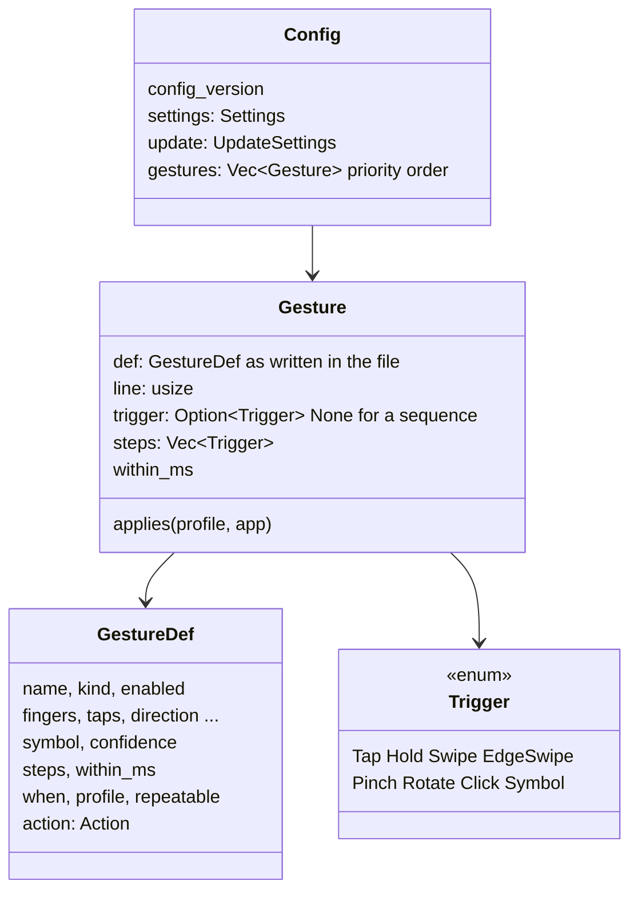

`config::parse(text) -> Result<Loaded, Vec<Diagnostic>>`: TOML → `GestureDef`s → validated
`Gesture`s (trigger built with `TriggerDef::build`, regexes compiled, steps checked: 2–4 steps,
no nested sequences, `within_ms` 100–5000). Errors carry **line, field and reason**; warnings
(e.g. a one-finger draw mode that clashes with ordinary touches, or an action that probably does nothing) are
returned beside the config. Native-gesture conflicts are logged at start by `warn_about_native_gestures`.
`config_version` guards against files written by a newer program.

### 10.3 Reading, hot reload, writing

```mermaid
sequenceDiagram
    participant FS as Config folder
    participant W as notify watcher
    participant S as Service (engine thread)
    participant G as GUI editor
    FS-->>W: file changed (editor, GUI save, user)
    W->>S: Command::FilesChanged
    S->>S: wait FILE_SETTLE (300 ms), compare text with last loaded
    alt text differs
        S->>S: parse; on error keep the last valid config + status/warnings
        S->>S: rebuild_engine(), revision += 1, update Shared
    end
    G->>G: draft valid and idle 700 ms
    G->>S: Command::WriteConfig{text, base_revision}
    alt file changed since base_revision
        S-->>G: refuse (write_refusals += 1) -> reload / keep mine / diff dialog
    else
        S->>S: validate, backup (throttled), atomic write (tmp + rename), reload
    end
```

- **A broken file never crashes or replaces the running config**; the last valid one stays active.
- Writes use `core::config_edit` (`toml_edit`), applied onto the *current text* so comments and
  formatting survive. Settings are changed with `Command::SetSetting{path, value}` /
  `RemoveSetting`.
- **Profiles**: `active_profile` is saved; `profile_rules` (exe → profile) switch temporarily without
  touching the file. The service keeps two configs: `loaded` (the file) and `config` (effective,
  with the rule's profile). The window edits `loaded`.

---

## 11. The service (engine thread)

`app/src/service.rs` (`Service`) owns everything mutable at runtime.

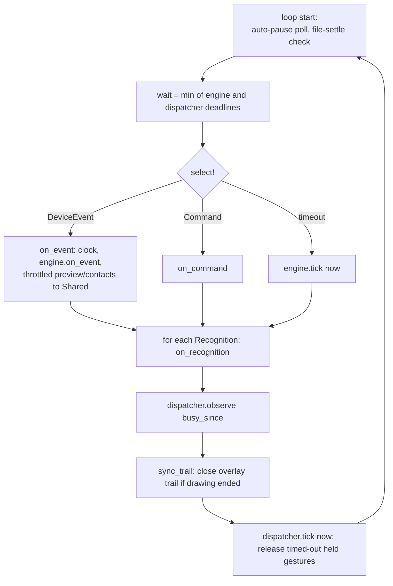

- **`EngineMode`**: `Normal` (recognize + run), `Test` (recognize, show, never run; used by `debug`
  and the "try it" mode), `RecordSymbol` (drawings become `Sample`s), `RecordDemonstration
  (everything recognized, nothing matched; feeds `infer`).
- `on_recognition` → in record modes, store into `Shared::recorded` and return; otherwise look up
  the foreground app and call the dispatcher.
- `on_dispatched` → overlay message, history entry (`Shared::history`, newest last, capped by
  `history_size`), stats, then `execute()`.
- `execute()` order: `toggle_enabled` always works → if paused, ignore → automatic pause
  (`pause_in_apps`, full-screen) → then by action: `repeat_last` (via `Repeater`), `draw_symbol`,
  `show_window`, profile actions, `show_cheat_sheet`, everything else goes to the actions thread and
  is recorded for `repeat_last`.
- `repeat_last` (`core/src/repeat.rs`) never records itself; excluded by default for lock, pause,
  window toggling…; optional timeout; `repeat_same_app_only`.
- **Shared / Command / UiLink** (`core/src/service.rs`) is the entire contract with the UI. The UI
  reads a cloned snapshot under a mutex and sends `Command`s; it never touches engine objects.
- Live feedback is throttled to 16 ms (`LIVE_INTERVAL`) **except the frame with no finger down**
  (§17). `sync_trail` compares `engine.drawing_preview()` with what the overlay shows.
- `watch_auto_pause` (1 s poll, only if configured) updates `Shared::auto_paused` and follows
  `profile_rules`; it will not switch profile while a finger is down.

---

## 12. Actions and feedback

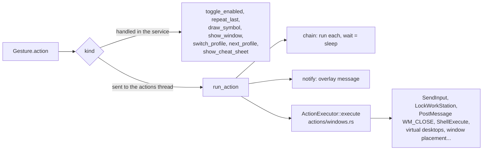

- The action set is `core::action::Action` (serde-tagged enum). Adding one touches: the enum, its
  validation (`Action::validate`/`kind`), `actions/src/windows.rs`, the GUI action editor
  (`gui/forms.rs`), the Italian strings and the docs (see recipe §18).
- Win+L cannot be injected with `SendInput`, hence the dedicated `lock_screen` action.
- Without administrator rights, keys and window actions do not reach elevated windows (UIPI).
- **Overlay** (`platform/windows/overlay.rs`): a layered, click-through, no-activate, topmost GDI
  window. States: hidden → *trail* (live drawing, watchdog timer ≥ 2 s re-armed by each update,
  closed explicitly by `end_trail`) → *message* (timed by `overlay.duration_ms`) → hidden.

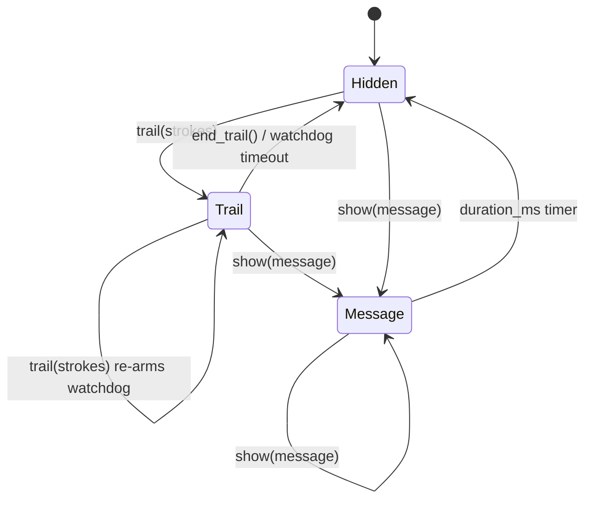

  `notify` actions are rendered by the overlay too (Windows toasts need an app identity a portable
  program lacks).
- **Cheat sheet** (`cheatsheet.rs` + `core::preview`): a list of the active gestures with
  pictograms, in its own layered window.

---

## 13. The window (GUI) and the tray

`crates/gui` is a view over `Shared`. Entry point `glyphpad_gui::run(Options, Host)`; the `Host`
gives it the shared state, the command channel, the `UiLink`, and closures for tray creation,
opening folders/URLs and bringing the window to front (so the crate stays free of app wiring).

| Page | Files | Role |
|---|---|---|
| Gestures | `gestures.rs`, `forms.rs`, `editor.rs`, `packs.rs` | List (search, filters, drag-and-drop priority), per-type forms, action editor, conditions, profiles, conflicts, import/export of `.glyphpad` packs. |
| Review | `review.rs`, `canvas.rs` | Template/trace playback on a pad-shaped canvas, history with overlay of the executed trace on the matching template, add as template / reassign. |
| Settings | `settings.rs` | Every `[settings]` and `[update]` option, "Advanced" collapsed, update banner. |
| Debug | `debug.rs` | Live contacts, drawing, candidates with threshold bars, device info. |
| Wizard | `wizard.rs` | Guided recording of a symbol or a gesture by demonstration (`EngineMode::Record*`, `core::infer`), quality check, similarity warning (`core::conflicts`), try-it mode. |

- **Design system**: `theme.rs` (palettes, type scale, spacing, fonts incl. the Phosphor icon
  subset in `assets/`), `widgets.rs` (the only place that draws controls). Pages never choose a
  color or size.
- **Autosave** (`editor.rs`): a *draft* with stable gesture `uid`s, undo/redo; when valid and idle
  for 700 ms it renders the draft onto the file text (`config_edit`) and sends
  `Command::WriteConfig` with the revision it started from; confirmation timeout 4 s. External
  changes while editing → dialog (reload / keep mine / differences).
- **i18n**: English literals are keys into `i18n/it.rs`; widgets take `&'static str`, so only
  program literals are translated (user text uses `*_raw` variants). Missing entry → English.
- **Hidden window = no UI pass**. Tray events and "show" requests are handled in `App::logic`,
  which eframe still calls when woken. The X button with `close_to_tray` sends `CancelClose` +
  `Visible(false)`.
- **Tray** (`app/src/tray.rs`, `tray-icon`): lives on the main thread with the event loop; menu
  events are queued and wake the window with `request_repaint`. The icon changes when paused.
- **Single instance** (`platform/windows/single_instance.rs`): a second launch signals the first to
  show its window, then exits. The updater can give the lock up and take it back (§14).
- Linux: the tray is optional by design (the app must work with just the window when AppIndicator
  is missing). Not built yet.

---

## 14. Updates

`crates/updater` (library, unit/integration-tested) + `app/src/update.rs` (the thread).

```mermaid
sequenceDiagram
    participant U as update thread
    participant SRC as UpdateSource (GitHub / Local)
    participant PK as package::download
    participant IN as install
    participant NEW as new process
    U->>SRC: latest release (ETag / If-None-Match, 403/429 backoff)
    SRC-->>U: version, notes, assets
    U->>U: semver compare, never downgrade, skip ignored
    Note over U: mode=notify: banner; mode=auto: wait until no finger is down
    U->>PK: download SHA256SUMS + package for this target
    PK->>PK: verify hash while writing, extract only the exe by name
    U->>IN: install: rename current to glyphpad.old(.exe), new into place
    U->>IN: handoff: release single-instance lock, spawn new exe + --post-update
    NEW->>NEW: load config, start engine
    NEW-->>U: write marker glyphpad-update.ok
    alt marker within 15 s
        U->>U: exit (new version runs)
    else timeout or new process dead
        U->>IN: kill it, rename old back, reacquire lock, notify failure
    end
```

- Repository fixed at compile time (`GITHUB_REPO`), User-Agent `glyphpad/<version>`, no token.
- A development (debug) build never replaces itself unless `--update-source <dir>` is given.
- If the executable's folder is not writable: no silent failure, a notification with the release link.
- Integrity is **SHA256SUMS only**; minisign signing (SPEC §12.3) is **not implemented** (the user chose
  to skip it). The release workflow is structured so it can be added later.
- `updater/tests/update_flow.rs` exercises replace, rollback with a broken binary and refusal of
  bad packages against a fake application, on every OS in CI.

---

## 15. Build, CI and release

```mermaid
flowchart LR
    DEV[commit on main] --> CI[ci.yml<br/>push to main]
    CI --> M{{windows-latest, ubuntu-latest}}
    M --> CHK[fmt --check, clippy -D warnings, test --locked]
    REL[cargo xtask release X.Y.Z] --> C1[checks: clean tree, fmt, clippy, tests]
    C1 --> C2[bump version, roll CHANGELOG]
    C2 --> C3[commit chore(release) + annotated tag vX.Y.Z]
    C3 --> PUSH[git push + push tag: needs the owner's OK]
    PUSH --> RW[release.yml on tag v*.*.*]
    RW --> V[xtask check-tag: tag == Cargo.toml version]
    V --> B1[build x86_64-pc-windows-msvc]
    V --> B2[build x86_64-unknown-linux-gnu]
    B1 --> PKG[glyphpad-VERSION-TARGET.zip / .tar.gz<br/>exe + example toml + README + LICENSE]
    B2 --> PKG
    PKG --> SUM[SHA256SUMS]
    SUM --> GH[GitHub Release: notes from CHANGELOG,<br/>pre-release if tag has a suffix]
```

- Actions are pinned to commit SHAs. Linux CI installs GTK, xdo and AppIndicator headers.
- Package names are fixed because the updater looks them up by name.
- No Authenticode signing: SmartScreen may warn on first run (documented in the README); the
  workflow has a spot where a signing step can be added.
- Local verification on Windows from WSL (target dir on a Windows disk because UNC builds are slow):
  `WSLENV=CARGO_TARGET_DIR/p CARGO_TARGET_DIR=/mnt/c/Users/temporary/glyphpad-target cargo.exe test --workspace`.
  **Linux `cargo clippy` does not compile the Windows code**: always also run `cargo.exe clippy
  --workspace --all-targets -- -D warnings`.

---

## 16. Testing strategy

| Layer | Where | How |
|---|---|---|
| State machines | `core/src/engine/tests.rs` and per-module tests | Synthetic frames (`Pad` helper builds taps/strokes), assert observations. |
| Recognizer | `core/src/symbols/tests.rs` | `proptest`: translation and scale must not change the result; $Q bounds vs exhaustive search. |
| Dispatcher | `core/src/dispatch.rs` tests | Hand-made `Recognition`s with start/end times. |
| **Real hardware regression** | `core/tests/fixtures.rs` + `tests/fixtures/*.jsonl` | Captures recorded on the reference pad (`glyphpad capture`) replayed with `dispatch::run_all`; expected results in `expected.toml`, config in `gestures.toml`, templates in `templates.json`. One capture per gesture kind. |
| Sequences on real data | `core/tests/sequences.rs` | Tap session + swipe session from fixtures, time-shifted to vary the pause. |
| HID / frame assembly | `platform/src/ptp.rs` tests | Pure functions, run everywhere. |
| Updater | `updater/tests/update_flow.rs` | Fake app, local source, rollback, bad signature/hash. |
| Config | `core/src/config.rs`, `config_edit.rs` tests | Error messages with line/field; comment-preserving edits. |

Workflow for a bug seen on the hardware: **capture it** (`glyphpad capture file.jsonl`), replay it
(`glyphpad replay file.jsonl [--all] [--frames]`), reproduce in a test, fix, keep the capture as a
fixture if it is a new case (no personal data is in a capture, only touch coordinates; do not
commit personal config).

Not covered by automatic tests (verify by hand on Windows): the overlay, tray, window show/hide,
`SendInput`-based actions, window arrangement, virtual desktops, screenshots, real GitHub updates.

---

## 17. Invariants and pitfalls

These are the things that have already caused bugs or will if forgotten.

1. **Never drop the lifting frame.** Throttling frames for the UI (16 ms) must always let through
   the frame with no finger down, or the Debug/recording views show ghost fingers, profile
   switching thinks a touch is in progress and the overlay stays open. (`Service::on_event`.)
2. **Time is the frame time base.** Never mix `Instant` and `*_us` timestamps; use
   `Service::now_us()` to convert. Deterministic tests rely on the engine never reading a clock.
3. **A recognition has three times** (`started_us`, `ended_us`, `at_us`). Windows for sequences use
   `ended_us` of the previous step and `started_us` of the next. Using `at_us` makes sequences
   depend on `stroke_gap_ms` and hold durations.
4. **A gesture may be silent for a while on purpose**: taps waiting for a possible double tap,
   strokes waiting for `stroke_gap_ms`, first steps of sequences waiting for `within_ms`. Always
   consider these delays before calling something "not recognized".
5. **The overlay must always be closable**: every code path that shows a trail needs an end
   (`end_trail`, a message, or the watchdog).
6. **Everything that changes engine state goes through the engine thread.** The GUI sends a
   `Command`; it does not call into the engine. `Shared` is a snapshot, clone cheaply (`Arc`s).
7. **`rebuild_engine()` resets in-flight state** (touch sessions, held sequence steps). Call it only
   when no finger is down if you can (profile rules already check).
8. **Draw mode and native Windows gestures conflict.** Three-finger drawing assumes Windows' own
   three-finger gestures are off; `warn_about_native_gestures` only warns.
9. **`unsafe`** only in `platform/windows/*` and `actions/windows.rs`, with a comment for each block.
   `core` must stay OS-free so it can be tested and replayed anywhere.
10. **Config safety**: parse before writing, write atomically, back up, never crash on a bad file.
11. **No macOS**: not even `cfg(target_os = "macos")`.
12. **The GitHub repository name appears only in `glyphpad_updater::GITHUB_REPO`** (and the `repository`
    field of `Cargo.toml`).
13. **Hot paths allocate little**: the engine is called per touch frame (up to hundreds per second);
    keep per-frame work small and avoid cloning big structures (use `Arc`).
14. **Never run a test executable with `autostart = true`**: it rewrites the HKCU `Run` key.
15. **Linux clippy does not check Windows-only code** (§15).

---

## 18. Recipes: how to change X

### Add a setting
1. Field + default in `core/src/config.rs` (`Settings`), validation if needed.
2. If the engine uses it: `Thresholds`/`Spec`/`DrawParams` conversion in `engine/mod.rs`.
3. `core::config_edit` writes settings generically through `SetSetting`; add the entry to the
   example config (`EXAMPLE_CONFIG`) with a comment.
4. GUI: a row in `gui/settings.rs` (default value shown, "restore default" button).
5. Strings in `gui/i18n/it.rs`; `docs/CONFIGURATION.md`; `CHANGELOG.md`.

### Add an action
1. Variant in `core::action::Action` (+ `kind()`, validation, `repeat::is_repeatable` if it should
   not be repeatable).
2. Implement in `actions/src/windows.rs` (or handle in `Service::execute` if it affects engine state).
3. Editor UI in `gui/forms.rs`; Italian strings; docs.

### Add a gesture type
1. `GestureKind` + `TriggerDef`/`Trigger` variants in `config.rs`/`trigger.rs` (build, validate,
   `specificity`).
2. A new `Observation` variant and a recognizer (or extend `MotionRecognizer`); register it in
   `Spec::from_config` and call it from `Engine::on_frame`/`tick`.
3. `core::preview` (pictogram), `core::infer` (demonstration), `core::conflicts` (overlap rules).
4. GUI form + `describe_trigger` (Italian sentence).
5. A real capture in `tests/fixtures` with an entry in `expected.toml`.

### Add a recognizer rule or threshold
Spatial values in **mm**, comment *why* the number is what it is, expose it in `Thresholds` and
Settings → Advanced only if users need it.

### Debug "my gesture does not fire"
1. `glyphpad debug` (Test mode: prints each recognition and its score, no action runs) or the Debug tab.
2. `glyphpad capture x.jsonl` the attempt, then `glyphpad replay x.jsonl --all --frames` to see
   what the engine saw.
3. Check, in order: finger count vs draw mode (3 fingers = stroke!), thresholds, `stroke_gap_ms`
   delay, a configured gesture with more taps/steps delaying it, profile/`when` conditions, the
   automatic pause (full-screen), `enabled = false`, confidence.
4. For sequences: the pause between steps vs `within_ms` (§9), and that every step is recognized on
   its own (`replay --all`).

### Release
`cargo xtask release X.Y.Z --dry-run`, then without `--dry-run` (checks, bump, changelog, commit,
annotated tag). Pushing the commit and the tag needs the owner's explicit OK; the tag push starts
`release.yml`. Verify with `gh run watch` and `gh release view vX.Y.Z`.

---

## 19. File map

```
Cargo.toml                  workspace; version single source of truth
.cargo/config.toml          alias `cargo xtask`, +crt-static
crates/core/src/
  model.rs                  TouchFrame, Contact, DeviceInfo, DeviceEvent
  source.rs                 TouchSource trait          replay.rs / capture.rs  captures
  engine/                   mod.rs (Engine, Spec, Thresholds, Recognition, Observation, resolve)
                            session.rs tap.rs hold.rs motion.rs chord.rs draw.rs tests.rs
  symbols/                  dollar_q.rs (matching) templates.rs (templates.json) mod.rs
  dispatch.rs               Dispatcher: gestures and sequences, run_all for replays
  trigger.rs                Trigger, specificity          infer.rs  deduce gestures from demos
  config.rs                 Settings, GestureDef, Gesture, parse() with diagnostics
  config_edit.rs            comment-preserving writes     conflicts.rs  overlaps, similar symbols
  action.rs                 Action, ActionExecutor, ForegroundInfo, AppInfo
  repeat.rs                 repeat_last                   keys.rs  key combos
  service.rs                Shared, Command, UiLink, EngineMode, HistoryEntry
  stats.rs usage.rs pack.rs preview.rs
crates/platform/src/
  ptp.rs                    HID math, FrameAssembler, ScanClock (portable)
  windows/                  source.rs hid.rs device.rs foreground.rs cursor.rs native_gestures.rs
                            overlay.rs cheatsheet.rs single_instance.rs autostart.rs console.rs
crates/actions/src/         lib.rs (executor(), foreground()), windows.rs
crates/gui/src/             lib.rs (run, App) gestures.rs forms.rs editor.rs review.rs settings.rs
                            debug.rs wizard.rs packs.rs canvas.rs theme.rs widgets.rs i18n.rs i18n/it.rs
crates/updater/src/         lib.rs source.rs package.rs install.rs state.rs   tests/update_flow.rs
crates/app/src/             main.rs (CLI, gui()) service.rs (engine thread) engine_loop.rs
                            live.rs config_file.rs tray.rs update.rs print.rs
xtask/src/                  main.rs changelog.rs manifest.rs
tests/fixtures/             real captures (.jsonl), gestures.toml, expected.toml, templates.json
.github/workflows/          ci.yml, release.yml
docs/                       SPEC.md ARCHITECTURE.md DESIGN.md CONFIGURATION.md USER_GUIDE.md GUIDA_UTENTE.md images/
```

CLI commands (`app/src/main.rs`): `run` (default), `debug`, `capture`, `replay`, `record`,
`dump-descriptor`, `check-config`, `update [--check]`, `--version`. Global flags: `--config`,
`--toplevel-window`, and (hidden) `--post-update`, plus `--update-source` in debug builds.
